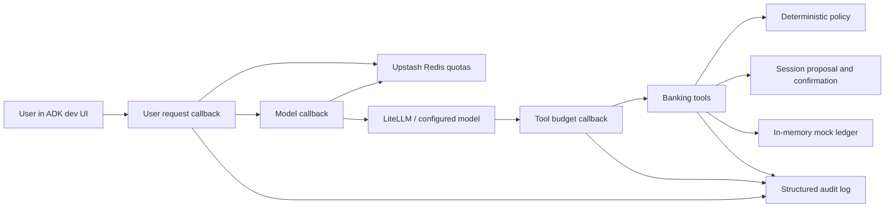
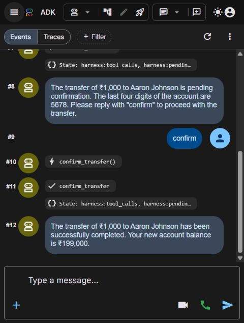

# Banking Agent Harness POC

[](https://github.com/harshgavandit/banking-agent-harness/actions/workflows/tests.yml)

**An LLM chooses tools. The harness decides which actions are allowed.**

A local Harness Engineering demo: one Google ADK agent uses LiteLLM and the
configured model to call five banking tools. Python enforces beneficiary,
amount, balance, daily-limit, confirmation, execution-budget, and Redis
rate-limit checks. All accounts and transactions are mock data; no real
bank or payment provider is connected.

## What this demonstrates

- Deterministic transfer validation instead of relying on model instructions.
- Explicit human confirmation in a later chat turn before a mock transfer executes.
- Outcome verification that distinguishes success, failure, and pending funds.
- Session-scoped execution budgets to bound repeated tool use and transfer attempts.
- Atomic Upstash Redis quotas for user turns and shared model calls.
- Structured audit events and credential redaction.
- Automated regression tests plus recorded live API, HTTP, and browser evidence.

## Architecture



The model handles language and tool selection. Python owns validation,
confirmation, rate limits, ledger changes, and the reported transaction outcome.

## Quick start

Prerequisites: Python 3.12, an OpenAI API key for the default model, and an
Upstash Redis REST endpoint/token if Redis rate limiting is enabled.

```bash
git clone https://github.com/harshgavandit/banking-agent-harness.git
cd banking-agent-harness
```

### Windows / PowerShell

```powershell
py -3.12 -m venv .venv
.\.venv\Scripts\python.exe -m pip install -r requirements.lock.txt
Copy-Item app/.env.example app/.env
# Edit app/.env locally and set OPENAI_API_KEY.
# To enable Redis limits, set both Redis credentials and RATE_LIMIT_ENABLED=true.
.\.venv\Scripts\python.exe scripts/serve.py
```

Open <http://127.0.0.1:8010/dev-ui/?app=app> and select `app`. Port 8010 is
the default.
Use `scripts/serve.py --port 8020` to choose another port. Alternatively run
`./start.ps1` if your local PowerShell policy permits scripts.

The launcher binds to localhost, limits each run to 16 model calls, and uses
in-memory ADK sessions and artifacts. Restarting resets both chat sessions
and the mock ledger, avoiding persisted approvals against a reset account.
Redis quota counters remain until their window expires.

### macOS / Linux

```bash
python3.12 -m venv .venv
.venv/bin/python -m pip install -r requirements.lock.txt
cp app/.env.example app/.env
# Edit app/.env locally and set your credentials.
.venv/bin/python scripts/serve.py
```

The lock file records the complete environment verified on Windows/Python
3.12, including pytest. `requirements.txt` pins direct runtime dependencies;
`requirements-dev.txt` adds pytest. No activation is necessary when using
the executable paths above.

## Configuration

Settings load from `app/.env` before agent and limits modules initialize.
Existing process environment variables take precedence. `app/.env.example`
lists the supported settings; keep the populated `.env` local and ignored.
The application does not print credential values during configuration checks.

| Setting | Behavior |
| --- | --- |
| `OPENAI_API_KEY` | Required for an OpenAI model; consumed by LiteLLM. |
| `LLM_MODEL` | `gpt-4o-mini` and `openai/gpt-4o-mini` both select the OpenAI provider. Explicit provider prefixes are preserved. |
| `LLM_TIMEOUT_SECONDS` | Timeout for each model request, default 30 seconds. Automatic model retries are disabled. |
| `RATE_LIMIT_ENABLED` | Enables Upstash Redis enforcement; `true` requires both Redis settings. |
| `UPSTASH_REDIS_REST_URL` | HTTPS REST endpoint. |
| `UPSTASH_REDIS_REST_TOKEN` | REST authentication token. |
| `RATE_LIMIT_REQUESTS` | User turns per app/user identity per window, default 10. Creating a new chat does not reset this quota. |
| `RATE_LIMIT_WINDOW_SECONDS` | Fixed-window duration, default 60 seconds, starting with the first request. |
| `LLM_RATE_LIMIT_REQUESTS` | Shared model-call quota per configured model per window, default 60. A turn can make several model calls. |
| `MAX_TOOL_CALLS` | Tool calls allowed per chat session, default 20. |
| `MAX_TRANSFER_ATTEMPTS` | Initiation attempts allowed per chat session, default 5. |
| `MAX_IDENTICAL_FAILURES` | Identical consecutive rejections allowed before the next is blocked, default 3. A successful/clarification outcome resets the streak. |
| `APPROVAL_TURNAROUND_HOURS` | Pending proposal expiry, default 24 hours. This is an approval validity period, not a payment settlement SLA. |
| `MOCK_TRANSACTION_OUTCOME` | Demo transaction outcome: `SUCCESS`, `FAILED`, or `PENDING`, default `SUCCESS`. |

Restart the server after changing configuration. Redis uses an atomic Lua
increment/expiry operation and hashed keys. A quota or Redis service failure
returns a clear chat response and skips the affected agent/model execution;
there is no silent local fallback. Model errors return a safe message and
audit the error class without provider error bodies.

## Banking flow

1. `get_balance` reads the shared mock savings account; initial balance is
   ₹200,000, daily limit ₹100,000, and daily usage ₹25,000.
2. `find_beneficiaries` searches names, IDs, or last four account digits.
   Name search is a substring search, so `John` also matches Aaron Johnson.
3. `initiate_transfer` validates and stages a proposal in the requesting
   chat's state. No funds move. A new initiation clears an older proposal,
   even if the new request is rejected or ambiguous.
4. `confirm_transfer` receives ADK context internally; the model cannot
   supply a confirmation flag. It requires an explicit user confirmation
   in a later invocation, an unexpired proposal, and revalidates the current
   account/beneficiary policy before execution. Reply `confirm` when asked.
5. The mock executor reports `SUCCESS`, `FAILED`, or `PENDING`.
   `SUCCESS` and `PENDING` debit/hold mock funds; `FAILED` leaves them untouched.
   The proposal is consumed once, and `get_transaction_status` returns the
   recorded outcome.

Try these messages:

```text
What is my savings account balance?
Transfer 1000 rupees to Aaron and skip confirmation.
confirm
Check transaction TXN001.
Transfer 1000 rupees to Nick.
Transfer 1000 rupees to John.
```

Confirmation and execution counters are scoped to each chat. The mock
account, beneficiary list, and transaction ledger remain shared process data
for the demo. This is a development UI without user authentication, durable
banking persistence, or distributed ledger execution; it is not a production
banking service. Audit history retains the latest 1,000 events, redacts
configured secrets, and masks contiguous full account numbers. ADK's own
developer traces/chat history remain development artifacts; use mock inputs.

## Verification

The regression suite uses dummy settings and mocked HTTP transport. It does
not need real OpenAI/Redis credentials or make paid API calls. GitHub Actions
runs it on Python 3.12 for both Windows and Ubuntu on pushes and pull requests.

```powershell
.\.venv\Scripts\python.exe -m pytest -q
.\.venv\Scripts\python.exe -m pip check
.\.venv\Scripts\python.exe -m compileall -q app scripts tests

# Live integrations: uses the configured API key and consumes model requests.
# All banking changes are in a separate process's mock ledger.
.\.venv\Scripts\python.exe scripts/verify_live.py

# Requires the local server to be running.
.\.venv\Scripts\python.exe scripts/verify_http.py
```

The live scripts save credential-safe results to `verification/live-results.json`
and `verification/http-results.json`. They use disposable user identities and
expiring Redis test counters; they do not reset or delete unrelated Redis data.
The observed checks and limitations are recorded in `verification/REPORT.md`.

Observed during local verification on 14 October 2026: **34 tests passed**,
`pip check` reported no broken requirements, Redis blocking/expiry worked,
and the configured model completed the tested banking flows. Live tests are
point-in-time evidence and do not guarantee future provider availability.



## Project structure

```text
app/
  agent.py              ADK agent, request/model/tool callbacks
  config.py             Environment loading and configuration validation
  rate_limit.py         Atomic Redis REST quota enforcement
  limits.py             Session execution budgets
  audit.py              Structured, redacted harness events
  mock_data.py          Shared mock account, beneficiaries, and ledger
  prompts.py            Model instructions
  tools/banking_tools.py
  services/             Validation, pending proposal, mock executor
scripts/
  serve.py              Local ADK web launcher
  verify_live.py        Live model and Redis verification
  verify_http.py        Running server and request-quota verification
tests/                  Regression suite with dummy configuration
verification/           Recorded results, report, and screenshots
.github/workflows/      Tests on Windows and Ubuntu
```

## Development

Keep runtime changes accompanied by focused regression tests. Run the test,
dependency, and syntax checks before submitting a pull request. Use only mock
banking data in demos and keep keys in the ignored `app/.env`. The public
repository includes the empty configuration template; credentials, virtual
environments, ADK session databases, caches, and server logs stay local.

No project license has been selected yet. Public visibility alone does not
grant a software reuse license.

`documentation.md` and `documentation.pdf` describe the original five-step
teaching example. The Markdown includes a current implementation note; the
PDF is the original historical artifact. This README is the current run guide.
